# Dental site templates

Thirteen dental practice websites that all read from one file. Fill in a client's details and pictures once, publish a preview to Cloudflare Workers, and they can see their practice in every design before picking one.

Plain HTML, CSS and a little JavaScript. No framework and no runtime dependencies; the build is a small Node script.

## For a new client

1. On GitHub: **Use this template → Create a new repository** (one repository per client).
2. Edit [`content/site.jsonc`](content/site.jsonc). It is the only file you need to touch, and every field is explained in place.
3. Put their pictures in `content/images/` and point the file at them.
4. Preview locally:

   ```bash
   npm install
   ```

   ```bash
   npm run dev
   ```

   Open http://localhost:4321. It rebuilds when you save.
5. Publish the preview:

   ```bash
   npm run deploy -- --name smith-dental-preview
   ```

   The first run asks you to log in to Cloudflare. The site appears at `https://smith-dental-preview.<your-subdomain>.workers.dev`. Previews tell search engines not to index them.

While `"design"` is `"all"` the site opens on a chooser page with every design, each one the full working site. When the client has chosen, set `"design"` to that name (for example `"sage"`) and deploy again: the site is then only that design, at the root.

### Going live

In `content/site.jsonc`: set `"demo": false`, clear `"credits"`, and under `"seo"` set `"url"` to the real address and `"indexable": true`. Deploy, then add the client's domain to the Worker in the Cloudflare dashboard (Workers & Pages → the Worker → Settings → Domains & Routes).

To deploy from GitHub instead of your machine, connect the repository in Workers & Pages → Create → Import a repository, with build command `npm run build` and deploy command `npx wrangler deploy`.

## The designs

Each is a recreation of one of the reference designs, with its own type, palette and first screen. Names, wording, drawings and code are original; nothing is taken from the references.

| | | |
| --- | --- | --- |
| 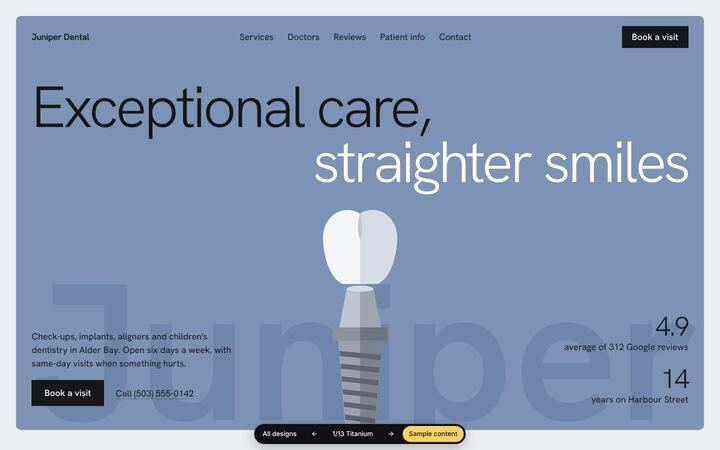 **titanium** |  **terracotta** |  **cobalt** |
| 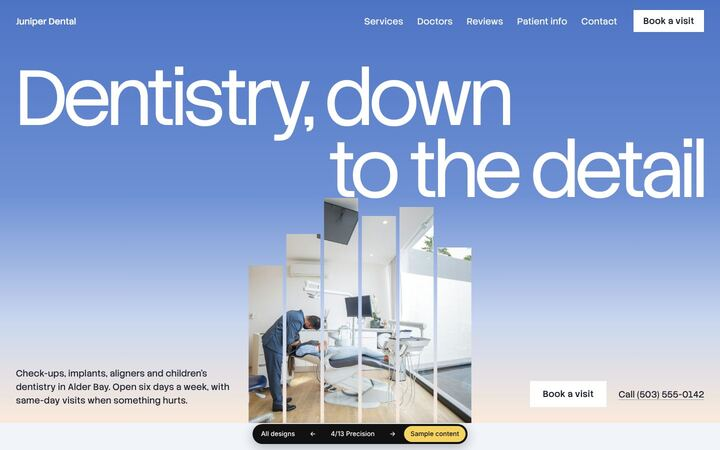 **precision** | 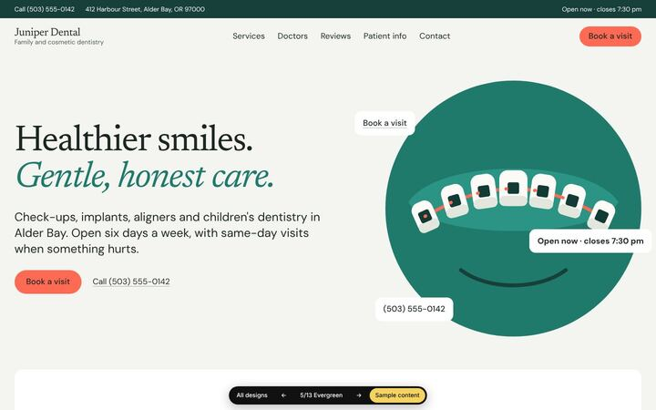 **evergreen** | 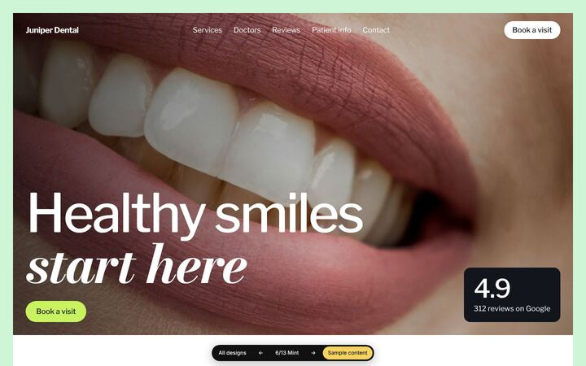 **mint** |
| 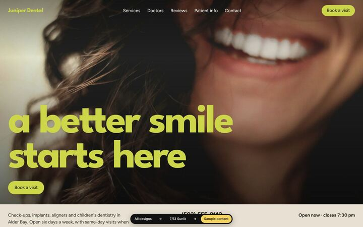 **sunlit** | 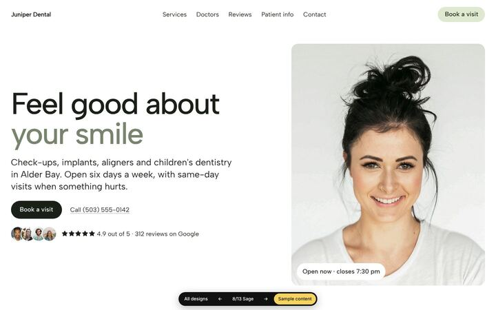 **sage** | 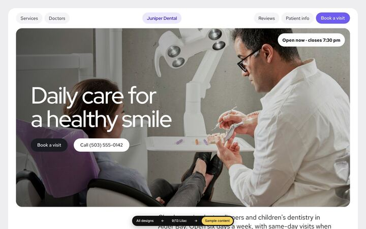 **lilac** |
| 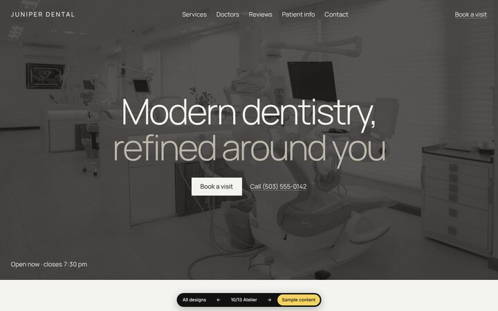 **atelier** | 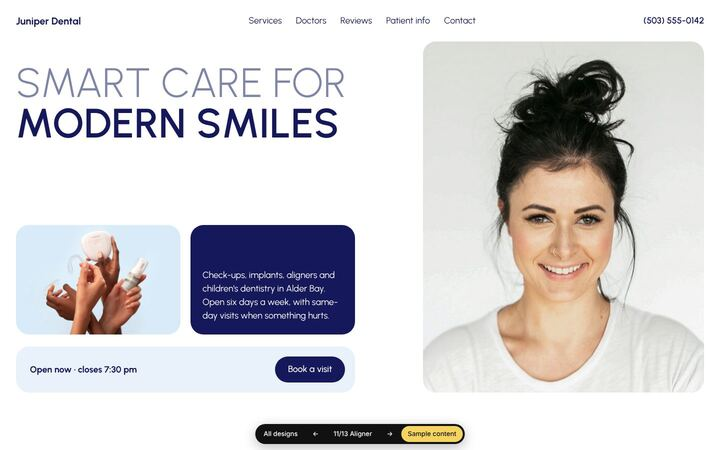 **aligner** | 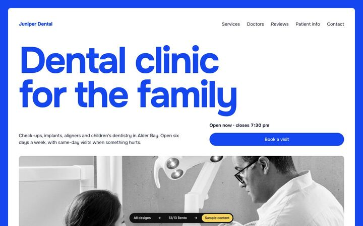 **bento** |
| 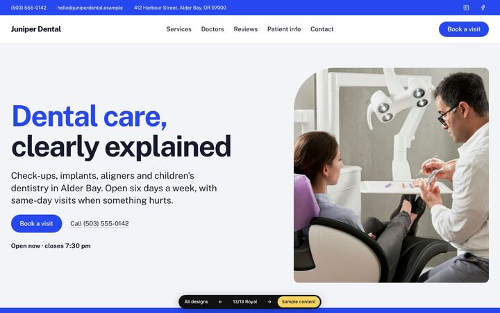 **royal** | | |

Every design has the same sections: navigation, first screen, services, doctors, reviews, patient info (topics and common questions), get in touch (hours, address, form), a footer, and a booking or call action in the header, the first screen, mid-page and the contact section.

Three things work the same in all of them:

- **Open now.** The hours you enter are turned into a live line ("Open now · closes 6 pm") in the practice's own time zone.
- **The form.** With `contact.formAction` set it posts there (Formspree, Basin, your own endpoint). Without one it opens the visitor's email app with their answers filled in, so it is never a dead end.
- **Missing pictures.** A slot with no picture shows a plain block (initials for people), never a broken image.

## Changing things

| To change | Edit |
| --- | --- |
| Details, pictures, wording | `content/site.jsonc` |
| Wording for one design only | `"perDesign"` in the same file |
| A design's colours or fonts | `"theme"` in the same file, using the tokens listed at the top of `designs/<name>/styles.css` |
| Button and form labels, or a translation | `"labels"` in the same file (full list: `LABELS` in `build/content.mjs`) |
| A design's layout | `designs/<name>/design.mjs` and `styles.css` |

Keep headings under about 40 characters. The build warns when one is too long to hold two lines.

Picture sizes: about 2000px wide for the wide slots, 1200px for services, 900×1125 for doctors, JPEG or WebP, under 400KB each. Set `"position"` on a picture to choose what stays in frame when it is cropped.

## Commands

| | |
| --- | --- |
| `npm run dev` | Build, serve and rebuild on save |
| `npm run build` | Build into `dist/` |
| `npm run build -- --design sage` | Build one design, whatever the file says |
| `npm run build -- --content clients/smith` | Build from another content folder |
| `npm run deploy -- --name <worker-name>` | Build and publish to Cloudflare Workers |
| `npm run check` | Photograph every page at desktop, tablet and phone width and report headlines over two lines, sideways scroll, low contrast, text at the screen edge and broken pictures. Needs Playwright (`npm i -D playwright`). |

## Design rules

The designs follow the house rules of the taste skill (`Jodad08/taste-skill`): headlines of two lines at most, running text at 16px or more in full ink, no drop shadows, hairlines, glass or eyebrow labels, equal page margins, real pictures, and motion that only adds to a page already in place.

Where a reference depends on something those rules ban, it is kept and listed in that design's `allow` in `design.mjs`: the gradient sky in `precision`, the clay-and-cream palette in `terracotta`, violet and pill navigation in `lilac`, the floating pill menu in `cobalt`, and the italic or second-tone words in the headlines of `evergreen` and `mint`.

To run the skill's own inspector on a built page:

```bash
node path/to/taste-skill/skills/taste-skill/scripts/inspect.mjs dist/sage/index.html --allow card-rows
```

## What is sample content

Everything in `content/` as shipped: the practice, its doctors, reviews, figures and fees are invented, and the photographs are stock pictures from Unsplash (listed in [`content/images/CREDITS.md`](content/images/CREDITS.md)). Replace all of it for a real practice. The build prints a warning for as long as `"demo"` is `true`.

Fonts are self-hosted open-source families ([`shared/fonts/README.md`](shared/fonts/README.md)). Interface icons are from Tabler Icons (MIT).
